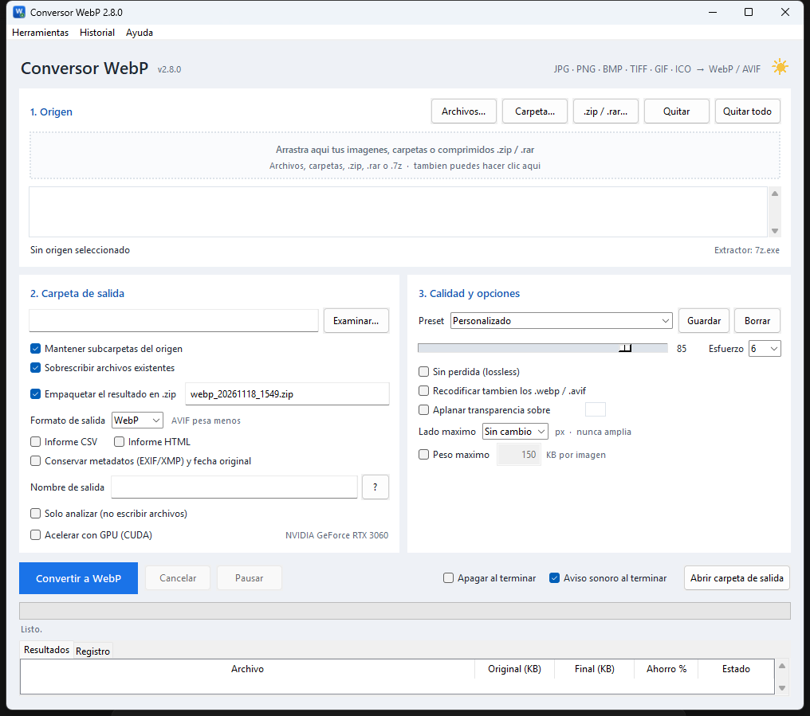

<p align="center">
  
</p>

<h1 align="center">Conversor WebP</h1>

<p align="center">
  Conversor de imágenes para Windows con interfaz gráfica y línea de comandos.<br>
  JPG · PNG · BMP · TIFF · GIF · ICO · TGA · PCX · DDS · PPM → <strong>WebP</strong> o <strong>AVIF</strong>
</p>

<p align="center">
  
  
  
  
  
</p>



---

## Índice

- [Qué es](#qué-es)
- [Características](#características)
- [Requisitos](#requisitos)
- [Instalación](#instalación)
- [Primeros pasos](#primeros-pasos)
- [La interfaz, sección por sección](#la-interfaz-sección-por-sección)
- [Presets](#presets)
- [Atajos de teclado](#atajos-de-teclado)
- [Historial de trabajos](#historial-de-trabajos)
- [Arrastrar y soltar](#arrastrar-y-soltar)
- [Comprimidos ZIP, RAR y 7Z](#comprimidos-zip-rar-y-7z)
- [Formato de salida: WebP y AVIF](#formato-de-salida-webp-y-avif)
- [Tamaño y peso de las imágenes](#tamaño-y-peso-de-las-imágenes)
- [Modo consola](#modo-consola)
- [Configuración guardada](#configuración-guardada)
- [Qué se conserva al convertir](#qué-se-conserva-al-convertir)
- [Limitaciones conocidas](#limitaciones-conocidas)
- [Manual completo](docs/MANUAL.md)
- [Arquitectura del código](docs/ARQUITECTURA.md)
- [Compilar el ejecutable](docs/COMPILAR.md)
- [Estructura del repositorio](#estructura-del-repositorio)
- [Registro de cambios](CHANGELOG.md)
- [Licencia](#licencia)

---

## Qué es

**Conversor WebP** es una aplicación de escritorio para Windows que transforma imágenes al formato
**WebP** (y opcionalmente **AVIF**), el estándar moderno que reduce el peso entre un **25 % y un 85 %**
frente a JPG o PNG con una calidad visual equivalente.

Todo el procesamiento ocurre **en tu equipo**: no hay telemetría, no se sube nada a Internet y los
archivos originales **nunca se modifican ni se borran**.

Puede trabajar con **imágenes sueltas, carpetas enteras o archivos comprimidos** (`.zip`, `.rar`, `.7z`),
guardar el resultado donde elijas, empaquetarlo en un ZIP y generar un informe CSV con los pesos.

El programa se distribuye en dos formas:

- **Ejecutable autocontenido** (`ConversorWebP.exe`): no requiere instalar Python.
- **Código fuente** (`conversor_webp.py`): un único archivo Python de ~1.900 líneas, con Tkinter y Pillow.

---

## Características

### Entrada y organización
- Imágenes **JPG, JPEG, JFIF, PNG, BMP, DIB, GIF, TIFF, ICO, TGA, PCX, DDS, PPM, PGM, PBM**, **HEIC/HEIF**.
- **Carpeta vigilada**: convierte automáticamente lo que aparezca en una carpeta.
- **Patrón de nombres** (`{nombre}_{ancho}x{alto}`, `{hash}`, `{fecha}`...).
- **Solo analizar**: calcula el peso estimado sin escribir archivos.
- **Tabla de resultados** con doble clic para abrir cada archivo.
- **Vista previa** antes/después con peso y ahorro.
- **Menú contextual** de Windows (imágenes, carpetas y comprimidos).
- **Instalador** y **versión portable**, con comprobación de actualizaciones.
- **Tooltips**: al pasar el ratón por cada opción se explica brevemente para qué sirve.
- **Apagado opcional** del equipo al terminar, con cuenta atrás de 30 s y botón de cancelar.
- Trabajo con **archivos sueltos**, **carpetas completas** (recursivo) y **comprimidos** ZIP/RAR/7Z.
- **Arrastrar y soltar** desde el Explorador de Windows en cualquier punto de la ventana.
- **Selección múltiple** en la lista de origen, con borrado por lote.
- Detección automática de **7-Zip** o **WinRAR** para los comprimidos.

### Conversión
- Salida **WebP** con pérdida, **WebP sin pérdida** o **AVIF**.
- **Calidad 1-100** y **esfuerzo 0-6**.
- **Redimensionado** por lado máximo (2560 / 1920 / 1600 / 1200 / 800 / 512 px), sin ampliar nunca.
- **Peso máximo por imagen** en KB: ajusta la calidad automáticamente para no superarlo.
- **Presets** incluidos y presets propios guardados por el usuario.
- Conversión **en paralelo** para lotes grandes.
- **Detección de la tarjeta gráfica** y modo **CUDA experimental** opcional (desactivado por defecto).
- Conserva **transparencia**, **perfil de color ICC** y corrige la **orientación EXIF**.
- Opción de **aplanar la transparencia** sobre un color sólido.

### Salida
- **Carpeta de salida** configurable, con conservación opcional de subcarpetas.
- **Sobrescribir u omitir** archivos existentes.
- **Empaquetado ZIP** opcional del resultado.
- **Informe CSV** con peso original, final, ahorro, estado y nota por archivo.
- **Nombre automático** y resolución de colisiones sin pisar archivos distintos.

### Experiencia de uso
- Interfaz en español, DPI alto y **modo claro u oscuro** con conmutador sol/luna; la preferencia se recuerda.
- Barra de progreso, cancelación segura y registro con colores.
- **Aviso sonoro** al terminar (agudo si va bien, grave si hay errores).
- **Historial** de los últimos 10 trabajos para repetirlos con un clic.
- **Menú Ayuda** con manual completo (F1) y ventana «Acerca de».
- **Acceso directo en “Enviar a”** del Explorador de Windows.
- **Modo consola** para automatizar.

---

## Requisitos

| Uso | Necesitas |
|---|---|
| Ejecutable `.exe` | Windows 10 u 11 (64 bits). Nada más. |
| Código fuente | Python 3.10 o superior (probado con 3.12). |
| Abrir `.rar` / `.7z` | [7-Zip](https://www.7-zip.org) o WinRAR instalados (los `.zip` funcionan sin nada). |

Dependencias de Python:

```
Pillow >= 10
tkinterdnd2 >= 0.4     # opcional: activa arrastrar y soltar
```

`tkinter` viene incluido con Python en Windows.

---

## Instalación

### Opción 1: ejecutable

1. Descarga desde la sección **Releases** la edición que prefieras:
   - **Instalador**: `ConversorWebP-Setup-x.y.z.exe` (recomendado).
   - **Portable**: `ConversorWebP-Portable-x.y.z.zip` (sin instalación).
   - **Solo el ejecutable**: `ConversorWebP.exe` (o compílalo tú, ver [docs/COMPILAR.md](docs/COMPILAR.md)).
2. Coloca el `.exe` donde quieras y ejecútalo.
3. Opcional: deja `MANUAL_DE_USO.html` junto al ejecutable para que el menú **Ayuda → Manual de uso**
   abra el manual. Si no está, se usa la copia incrustada en el propio `.exe`.

> Windows puede mostrar el aviso de SmartScreen por no estar firmado. Es normal en programas nuevos:
> pulsa **Más información → Ejecutar de todas formas**.

### Opción 2: desde el código

```bash
git clone https://github.com/zeronet75/ConversorWebP.git
cd ConversorWebP
python -m venv .venv
.venv\Scripts\activate
pip install -r requirements.txt
python conversor_webp.py
```

---

## Primeros pasos

1. Abre el programa.
2. Añade contenido: arrastra imágenes, una carpeta o un `.zip`/`.rar` a la ventana, o usa los botones.
3. Elige la **carpeta de salida** con `Examinar…`.
4. Ajusta la calidad (85 es un buen punto de partida) y, si quieres, el formato, el tamaño o el peso.
5. Pulsa **Convertir**. Al terminar verás el resumen y podrás abrir la carpeta con
   **Abrir carpeta de salida**.

---

## La interfaz, sección por sección

### 1. Origen

| Elemento | Función |
|---|---|
| **Archivos…** | Selecciona una o varias imágenes. |
| **Carpeta…** | Añade una carpeta completa, incluidas sus subcarpetas. |
| **.zip / .rar…** | Añade uno o varios comprimidos (`.zip`, `.rar`, `.7z`). |
| **Quitar** | Quita de la lista las entradas seleccionadas. |
| **Quitar todo** | Vacía la lista sin tocar el disco. |
| **Zona punteada** | Zona de arrastre; un clic equivale a *Archivos…*. |
| **Lista** | Muestra cada origen con la etiqueta `[carpeta]` o `[comprimido]`. |
| **Contador** | Resume cuántos orígenes de cada tipo hay. |
| **Extractor** | Indica qué herramienta se usará para RAR/7Z. |

### 2. Carpeta de salida

| Opción | Significado |
|---|---|
| **Examinar…** | Elige la carpeta de destino. |
| **Mantener subcarpetas del origen** | Reproduce la estructura de carpetas original. Desactivado, todo queda plano. |
| **Sobrescribir archivos existentes** | Activado reemplaza; desactivado omite lo ya convertido. |
| **Empaquetar el resultado en .zip** | Crea además un ZIP con los archivos generados. |
| **Nombre del ZIP** | Editable; se añade `.zip` si falta. |
| **Formato de salida** | **WebP** o **AVIF**. |
| **Guardar informe CSV** | Deja un CSV con el detalle de cada archivo. |

### 3. Calidad y opciones

| Opción | Significado |
|---|---|
| **Preset** | Aplica una combinación guardada de opciones. |
| **Guardar / Borrar** | Crea o elimina presets propios. |
| **Calidad (1-100)** | Más calidad = mejor aspecto y más peso. 85-92 para web. |
| **Esfuerzo (0-6)** | Cuánto trabaja el compresor. 6 comprime más, tarda algo más. |
| **Sin pérdida (lossless)** | Compresión sin descartar píxeles. Para capturas, logos e iconos. |
| **Recodificar también los .webp / .avif** | Vuelve a procesar archivos que ya están en el formato destino. |
| **Aplanar transparencia sobre** | Rellena el alfa con un color sólido. |
| **Lado máximo** | Reduce el lado mayor a 2560/1920/1600/1200/800/512 px sin ampliar. |
| **Peso máximo** | Ajusta la calidad para no superar los KB indicados por imagen. |

### Barra inferior

| Elemento | Función |
|---|---|
| **Convertir** | Comprueba los datos y arranca la conversión. |
| **Cancelar** | Detiene el proceso tras el archivo en curso; lo convertido se conserva. |
| **Aviso sonoro al terminar** | Pitido final (desactivable). |
| **Apagar al terminar** | Apaga el equipo tras una conversión correcta, con cuenta atrás cancelable. Desactivado por defecto. |
| **Abrir carpeta de salida** | Abre el Explorador en el destino. |
| **Barra de progreso** | Archivos procesados y porcentaje. |
| **Registro** | Verde = convertida, rojo = error, ámbar = aviso, gris = omitida. |

---

## Presets

| Preset | Aplica |
|---|---|
| **Web (85 · 1920 px)** | Calidad 85, esfuerzo 6, lado máximo 1920 px. |
| **Catálogo (80 · 1200 px)** | Calidad 80, lado máximo 1200 px. |
| **Iconos sin pérdida** | Lossless, sin redimensionar. |
| **Máxima calidad (95)** | Calidad 95, sin redimensionar ni límite de peso. |

Al modificar cualquier opción, el desplegable pasa a **Personalizado**. Con **Guardar** se almacena la
configuración actual con un nombre propio y queda disponible en futuras sesiones. **Borrar** elimina el
preset propio seleccionado.

---

## Atajos de teclado

| Atajo | Acción |
|---|---|
| `Ctrl` + `O` | Añadir archivos |
| `Ctrl` + `Mayús` + `O` | Añadir carpeta |
| `Ctrl` + `Enter` o `F5` | Convertir |
| `Supr` | Quitar las entradas seleccionadas |
| `F1` | Abrir el manual |

---

## Historial de trabajos

El menú **Historial** guarda los últimos **10 trabajos** (orígenes, destino y ajustes). Al elegir una
entrada se recupera todo y solo hay que pulsar **Convertir**. También permite vaciar el historial.

---

## Arrastrar y soltar

Se puede soltar contenido en **cualquier punto de la ventana**:

- imágenes sueltas o varias seleccionadas,
- carpetas completas (con subcarpetas),
- comprimidos `.zip`, `.rar` y `.7z`,
- una mezcla de todo.

Si se suelta algo que no es imagen ni comprimido, el programa lo ignora y avisa de cuántos descartó.

### Enviar a del Explorador

En **Herramientas → Añadir a “Enviar a” del Explorador** se crea un acceso directo real en
`%APPDATA%\Microsoft\Windows\SendTo`. Después:

1. Selecciona fotos o un comprimido en el Explorador.
2. Clic derecho → **Enviar a** → **Conversor WebP**.
3. La aplicación se abre con esos archivos ya cargados.

Se puede quitar desde **Herramientas → Quitar de “Enviar a”**.

---

## Comprimidos ZIP, RAR y 7Z

- Los **ZIP** se abren con un lector interno (seguro frente a rutas maliciosas), sin instalar nada.
- Los **RAR** y **7Z** usan 7-Zip o WinRAR; el programa los busca en las rutas habituales y en el `PATH`.
- El contenido se extrae a una **carpeta temporal que se borra al terminar**.
- Se conserva la estructura interna del comprimido.
- Si hay **varios comprimidos**, cada uno se guarda en una subcarpeta con su nombre.
- Los comprimidos anidados dentro de otro no se abren: extrae primero el exterior.

---

## Formato de salida: WebP y AVIF

| | WebP | AVIF |
|---|---|---|
| Compatibilidad | Universal (navegadores, móviles, Windows) | Buena, pero algunos programas antiguos no lo abren |
| Peso | Muy bueno | 20-30 % menos con calidad similar |
| Velocidad | Rápido | Más lento |
| Transparencia / ICC | Sí | Sí |
| Sin pérdida | Sí | Sí |

El botón principal y la extensión de los archivos se adaptan al formato elegido.

---

## Tamaño y peso de las imágenes

- **Lado máximo**: reduce la resolución; nunca amplía imágenes pequeñas.
- **Peso máximo**: búsqueda binaria de calidad (hasta 7 pruebas) para quedar por debajo del límite.
  El valor del deslizador actúa como tope superior. Si ni con calidad 1 se consigue, guarda igualmente y
  lo indica en el registro.
- En modo **sin pérdida** no se aplica el peso máximo (no se puede ajustar la calidad sin perder fidelidad).

---

## Aceleración GPU (experimental, desactivada por defecto)

La aplicación **detecta la tarjeta gráfica** al arrancar (registro de Windows + `nvidia-smi`) y muestra su
nombre junto a la casilla `Acelerar con GPU (CUDA)`. El modo CUDA está **desactivado por defecto** porque,
en las pruebas reales, la conversión por CPU en paralelo resulta más rápida para lotes.

### Por qué está desactivado

El codificador WebP/AVIF de Pillow es **CPU**; la GPU solo puede decodificar JPEG (nvJPEG) y reescalar.
Además, la app ya reparte el trabajo entre varios hilos de CPU. Medido en una RTX 3060:

| Escenario | CPU | GPU | Resultado |
|---|---|---|---|
| 1 foto de 24 MP → 1920 px | 669 ms | 435 ms | 1,54× más rápida |
| 1 foto de 24 MP → 1200 px | 317 ms | 158 ms | 2,00× más rápida |
| 60 fotos de 24 MP → 1600 px (app completa) | **12,5 s** | 18,0 s | **CPU 1,44× más rápida** |

La causa: cargar CUDA cuesta ~7,5 s y la GPU no puede paralelizar la codificación, mientras que la CPU usa
8 hilos. Solo compensa en casos concretos (una imagen enorme suelta, CPU muy cargada o equipo con CPU
modesta), por lo que queda como opción manual.

### Cuándo se usaría

Si la activas, la ruta GPU se aplica solo cuando el archivo es **JPEG RGB**, tiene **8 MP o más** y se va a
**reducir**. En lotes pequeños ni siquiera se carga CUDA salvo que marques
`Herramientas → Forzar GPU en lotes pequeños` o uses `--gpu`. Cualquier fallo de CUDA revierte a CPU para
esa imagen.

### Cómo activarla

- **Ejecutable**: usa el PyTorch CUDA que ya tengas instalado; lo busca en entornos habituales
  (`...\.venv\Lib\site-packages`, Python del sistema, una carpeta `gpu` junto al `.exe`). Puedes indicar la
  carpeta en `Herramientas → Aceleración GPU`.
- **Desde el código**:

  ```bat
  pip install -r requirements-gpu.txt --index-url https://download.pytorch.org/whl/cu121
  python conversor_webp.py
  ```

- Comprueba el estado en `Herramientas → Aceleración GPU` o con
  `ConversorWebP.exe --diag "%TEMP%\diag.json"`.

### Límites

- Solo se acelera JPEG grande reducido; PNG, WebP, AVIF, GIF y BMP van por CPU.
- La codificación final siempre es CPU.
- El `.exe` no incluye PyTorch (ocuparía ~2,4 GB); lo carga de la instalación del sistema si existe.

---

## Automatización y extras (2.5)

### Carpeta vigilada

`Herramientas → Carpeta vigilada...` permite elegir una carpeta de entrada y otra de salida. El programa
la revisa cada 3 segundos y convierte automáticamente las imágenes (y comprimidos) que aparezcan, con los
ajustes actuales. Se detiene desde el mismo menú o al cerrar la aplicación. Los archivos que ya existen en
destino no se sobrescriben.

### Patrón de nombres

Campo **Nombre de salida** de la tarjeta de destino. Vacío conserva el nombre original. Marcadores:

| Marcador | Valor |
|---|---|
| `{nombre}` | Nombre original sin extensión |
| `{ancho}` / `{alto}` | Dimensiones finales en píxeles |
| `{hash}` | SHA-1 corto del archivo original |
| `{fecha}` | `AAAAMMDD-HHMMSS` |
| `{formato}` | `webp` o `avif` |
| `{calidad}` | Calidad configurada |

Ejemplo: `{nombre}_{ancho}x{alto}` genera `foto_1600x1200.webp`.

### Solo analizar

Marca **Solo analizar (no escribir archivos)** para calcular el peso estimado de todo el lote sin crear
imágenes. Con «Guardar informe CSV» se obtiene un `analisis_*.csv` con los tamaños estimados.

### Vista previa

`Herramientas → Vista previa de la primera imagen` convierte una imagen de muestra en memoria y muestra
original y resultado lado a lado con dimensiones, peso y ahorro.

### Menú contextual de Windows

`Herramientas → Añadir al menú contextual de Windows` registra (solo HKCU, sin administrador) la opción
**Convertir a WebP con Conversor WebP** para imágenes, carpetas y archivos `.zip`, `.rar` y `.7z`.
Se elimina desde el mismo menú.

### HEIC/HEIF

Con `pillow-heif` instalado (incluido en el ejecutable), se pueden abrir fotos de iPhone `.heic`/`.heif`
y convertirlas como cualquier otra imagen.

---

## Instalador y versión portable

Hay dos ediciones con el mismo programa:

| Edición | Configuración | Uso |
|---|---|---|
| **Instalador** (`ConversorWebP-Setup-x.y.z.exe`) | `%APPDATA%\ConversorWebP\config.json` | Instala en `%LOCALAPPDATA%\Programs` (sin administrador), crea accesos en Inicio/Escritorio y desinstalador. |
| **Portable** (`ConversorWebP-Portable-x.y.z.zip`) | `config.json` junto al `.exe` (por `portable.txt`) | Descomprimir en una carpeta o USB y ejecutar; no escribe en el registro ni en `%APPDATA%`. |

Ambas incluyen el manual, el mismo motor y la comprobación de actualizaciones.

### Actualizaciones

Al arrancar, si han pasado más de 24 horas, se consulta la última release del repositorio y se muestra
`Actualizacion disponible: vX.Y.Z` en la barra de estado. `Ayuda → Buscar actualizaciones` fuerza la
comprobación y, si hay una nueva, ofrece abrir la página de descarga. No se instala nada automáticamente.


---

## Modo consola

El mismo ejecutable funciona sin ventana. Sin argumentos, abre la interfaz.

```text
ConversorWebP.exe <origen...> -o <carpeta_salida> [opciones]
```

| Opción | Descripción |
|---|---|
| `-o, --output` | Carpeta de salida (obligatoria en modo consola). |
| `-q, --quality` | Calidad 1-100. Por defecto 85. |
| `-m, --method` | Esfuerzo 0-6. Por defecto 6. |
| `--format webp\|avif` | Formato de salida. Por defecto WebP. |
| `--max-dim N` | Lado máximo en píxeles (no amplía). |
| `--max-kb N` | Peso máximo por imagen en KB. |
| `--zip NOMBRE` | Crea un ZIP con el resultado. |
| `--csv` | Genera el informe CSV. |
| `--lossless` | Modo sin pérdida. |
| `--flat` / `--bg "#ffffff"` | Aplanar transparencia sobre un color. |
| `--no-recursive` | No mantener subcarpetas. |
| `--no-overwrite` | Omitir archivos existentes. |
| `--webp` | Recodificar también los `.webp`. |
| `--shutdown` | Apaga el equipo al terminar correctamente (60 s). |
| `--shutdown-delay N` | Segundos antes de apagar (mínimo 10). |

### Ejemplos

```bat
:: Convertir un RAR completo, con ZIP e informe
ConversorWebP.exe "C:\Fotos\vacaciones.rar" -o "C:\Fotos\webp" --zip vacaciones.zip --csv

:: Lote para web: 1600 px, máximo 150 KB, AVIF
ConversorWebP.exe "C:\Fotos\productos" -o "C:\Fotos\tienda" --format avif --max-dim 1600 --max-kb 150

:: Logos sin pérdida
ConversorWebP.exe "C:\Marca\logos" -o "C:\Marca\logos_webp" --lossless
```

### Códigos de salida

| Código | Significado |
|---|---|
| `0` | Todo correcto. |
| `1` | Hubo algún archivo fallido. |
| `2` | Error de argumentos. |

Si se pasan rutas sin `-o` (por ejemplo desde “Enviar a”), el programa abre la interfaz con esos archivos
ya cargados.

---

## Configuración guardada

Los ajustes se guardan en:

```text
%APPDATA%\ConversorWebP\config.json
```

Incluye calidad, esfuerzo, formato, casillas, presets propios, historial, última carpeta de salida y
nombre del ZIP. Para volver a la configuración de fábrica, cierra el programa y borra ese archivo.

---

## Qué se conserva al convertir

| Aspecto | Comportamiento |
|---|---|
| Orientación EXIF | Se aplica; las fotos verticales no salen giradas. |
| Transparencia | Se conserva (PNG, GIF, WebP, AVIF), salvo que se aplique «aplanar». |
| Perfil ICC | Se mantiene si la imagen lo lleva. |
| GIF animados | Se convierten a **WebP animado**; AVIF usa el primer fotograma. |
| Metadatos EXIF/GPS | No se copian (archivos más ligeros y sin datos de ubicación). |
| Archivos originales | Nunca se modifican ni se borran. |

---

## Limitaciones conocidas

- **GIF animados**: se genera WebP animado; en AVIF se usa el primer fotograma.
- **JPEG en CMYK**: se convierte a RGB de forma estándar; en imágenes de imprenta con perfil CMYK los
  colores pueden variar ligeramente.
- **RAR/7Z**: requieren 7-Zip o WinRAR instalados.
- **Comprimidos anidados**: no se recorren.
- **Ejecutable sin firma**: Windows puede mostrar el aviso de SmartScreen.

---

## Arquitectura del código

Todo el detalle técnico (modelo de datos, hilos, flujo de un trabajo, puntos de extensión) está en
**[docs/ARQUITECTURA.md](docs/ARQUITECTURA.md)**.

Resumen: un único módulo con tres capas — utilidades de archivos/comprimidos, motor de conversión
(`Job`, `Result`, `run_job`, `convert_one`) y la interfaz Tkinter (`App`). La conversión corre en un hilo
de trabajo que se comunica con la UI mediante una cola de eventos; los lotes se reparten con
`ThreadPoolExecutor`.

## Manual completo

- **[docs/MANUAL.md](docs/MANUAL.md)** — manual navegable aquí en GitHub, con todas las opciones explicadas.
- **[MANUAL_DE_USO.html](MANUAL_DE_USO.html)** — versión ilustrada e imprimible (se abre en el navegador;
  el programa la usa en `Ayuda → Manual de uso`).
- **[LEEME.txt](LEEME.txt)** — guía rápida de una página.

---

## Compilar el ejecutable

Instrucciones completas en **[docs/COMPILAR.md](docs/COMPILAR.md)**. Resumen:

```bat
pip install -r requirements-dev.txt
pyinstaller --noconfirm --clean --onefile --windowed --name ConversorWebP ^
  --icon icon.ico --collect-all tkinterdnd2 --add-data "MANUAL_DE_USO.html;." ^
  conversor_webp.py
```

## Pruebas

```bat
python -m unittest discover -s tests -v
```

Las pruebas generan sus propias imágenes en una carpeta temporal y cubren conversión, transparencia,
redimensionado, peso objetivo, AVIF, ZIP seguro, omisión de existentes y comprimidos múltiples.

---

## Estructura del repositorio

```text
ConversorWebP/
├── conversor_webp.py       Aplicación completa (GUI + CLI)
├── MANUAL_DE_USO.html      Manual de usuario ilustrado
├── LEEME.txt               Guía rápida
├── icon.ico / icon.png     Icono de la aplicación
├── ConversorWebP.spec      Especificación de PyInstaller
├── instalador/
│   └── ConversorWebP.iss   Script de Inno Setup
├── requirements.txt        Dependencias de ejecución
├── requirements-dev.txt    Dependencias para compilar
├── requirements-gpu.txt    PyTorch CUDA opcional
├── CHANGELOG.md            Historial de versiones
├── CONTRIBUTING.md         Guía para contribuir
├── LICENSE                 Licencia MIT
├── docs/
│   ├── MANUAL.md           Manual completo en Markdown (navegable en GitHub)
│   ├── ARQUITECTURA.md     Diseño técnico del programa
│   ├── COMPILAR.md         Cómo generar el .exe
│   └── img/ventana.png     Captura de la interfaz
├── tools/
│   └── html_a_md.py        Regenera docs/MANUAL.md desde el HTML (opcional)
├── tests/
│   ├── test_conversor.py   Pruebas del motor (unittest)
│   └── test_nuevas.py      Pruebas de patrones, dry-run, HEIC y portable
└── .gitignore
```

---

## Registro de cambios

Consulta [CHANGELOG.md](CHANGELOG.md). Resumen:

- **2.8.0** — portapapeles, informe HTML, presets JSON, TGA/PCX/PPM en C++ y escalado GDI.
- **2.7.0** — cola persistente, vista previa interactiva, WebP animado, metadatos, CLI ampliado y mejoras de robustez.
- **2.6.5** — correcciones de robustez en Python y C++, CSV, cierre seguro, vista previa y CLI.
- **2.6.4** — corrige el solape del selector «Lado máximo» en la edición C++.
- **2.6.3** — modo oscuro conmutable en las dos ediciones, con icono sol/luna y preferencia guardada.
- **2.6.2** — actualización automática desde la app: descarga verificada, instalación y reinicio.
- **2.6.1** — edición C++ con paridad funcional, icono de aplicación, selector de color visible y correcciones.
- **2.6.0** — apagado opcional del equipo al terminar, con cuenta atrás cancelable.
- **2.5.1** — tooltips explicativos en todos los controles y descripciones en los menús.
- **2.5.0** — HEIC, carpeta vigilada, patrones, dry-run, tabla, vista previa, menú contextual, instalador, portable y actualizaciones.
- **2.4.1** — elimina el menú «Acerca de» duplicado de la barra superior; queda en Ayuda.
- **2.4.0** — detección de GPU y modo CUDA experimental (desactivado por defecto).
- **2.3.1** — corrección de color CMYK, historial completo, nombres de ZIP seguros y otros ajustes.
- **2.3** — presets, redimensionado, peso objetivo, historial, atajos, paralelo, CSV, AVIF y “Enviar a”.
- **2.2** — menú Historial y mejoras internas de la interfaz.
- **2.1** — aviso sonoro al terminar.
- **2.0** — arrastrar y soltar, comprimidos ZIP/RAR/7Z, menú Ayuda y manual.
- **1.0** — conversor básico con interfaz.

---

## Licencia

Distribuido bajo licencia **MIT**. Consulta [LICENSE](LICENSE).

Hecho por [zeronet75](https://github.com/zeronet75).
